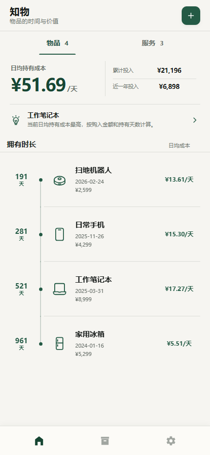
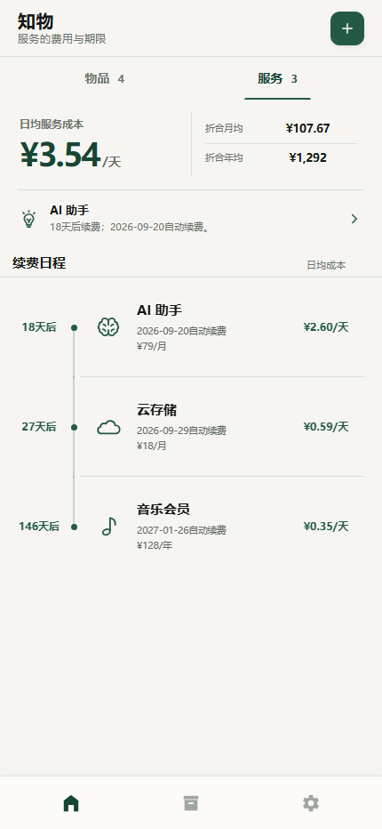
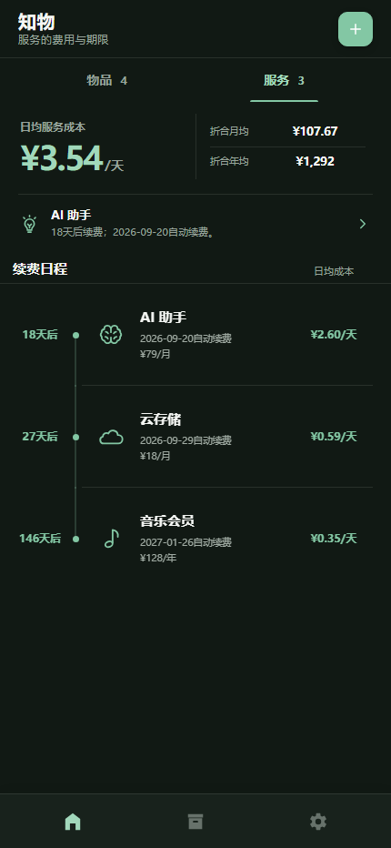
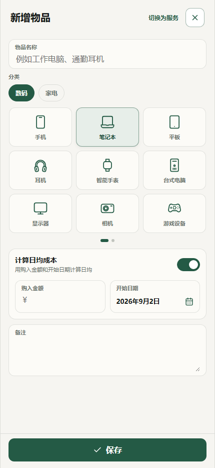
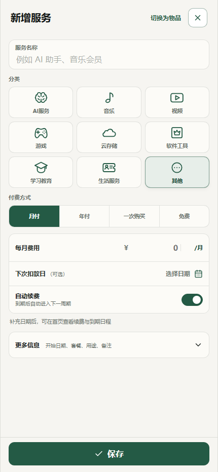
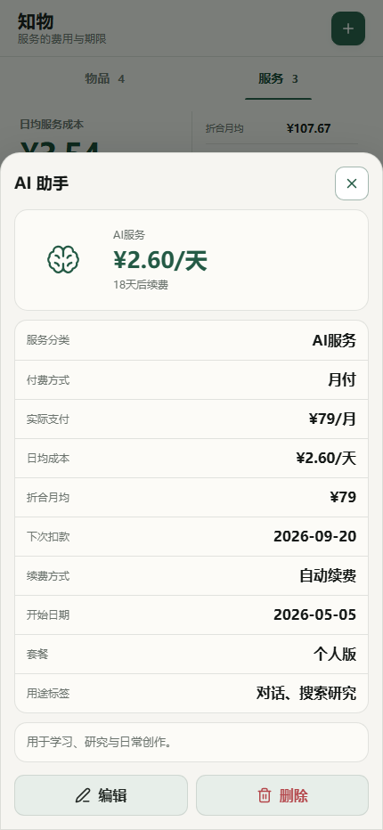

<div align="center">
  
  <h1>Zhiwu · 知物</h1>
  <p><strong>See the time in your belongings—and the value in your spending.</strong></p>
  <p>A local-first value tracker for personal belongings and subscriptions.</p>
  <p>
    <a href="README.md">简体中文</a> ·
    <a href="README.en.md">English</a>
  </p>
  <p>
    <a href="https://godiceman.github.io/zhiwu/">Live Demo</a> ·
    <a href="https://github.com/GodIceman/zhiwu/releases">Android</a> ·
    <a href="CHANGELOG.md">Changelog</a>
  </p>
</div>

> No account and no backend. Your belongings, costs, and notes stay on your device and remain exportable.

## Why Zhiwu

Most spending records end at checkout, while the real value of a purchase unfolds afterwards: how long it stays useful, how often it is used, and what it actually costs per day. Digital subscriptions add another recurring layer that rarely appears alongside physical belongings.

Zhiwu brings both into one time-and-cost view, making personal spending easier to understand over time.

<div align="center">
  
  
  
</div>

## Highlights

- **Belonging value** — Calculate daily holding cost from price and ownership time.
- **Subscription tracking** — Manage monthly, annual, one-time, and free services together.
- **Time-based insight** — See ownership duration and upcoming renewals at a glance.
- **A coherent visual system** — Purpose-built line icons for physical and digital categories.
- **Local first** — Personal records stay in IndexedDB instead of being uploaded.
- **Portable data** — Back up and restore JSON or export CSV at any time.
- **Web and Android** — Use Zhiwu as a PWA or build the Capacitor Android app.

<div align="center">
  
  
  
</div>

## Data and privacy

Zhiwu has no account system or remote application backend. Records are stored in the browser or Android WebView database. Export a JSON backup before uninstalling the app, clearing site data, or moving to another device.

Read the full [data and privacy note](docs/PRIVACY.md).

## Run locally

Node.js 22 or later is recommended.

```bash
npm install
npm run dev
```

Run all quality checks:

```bash
npm run check
```

Build the Web/PWA app:

```bash
npm run build
```

Sync the Android project:

```bash
npm run android:sync
```

## Built with

- React, TypeScript, and Vite
- IndexedDB with `idb`
- Vitest, Testing Library, and Playwright
- Vite PWA
- Capacitor Android
- GitHub Actions and GitHub Pages

The product decisions, quality loop, and human–AI workflow are documented in [Building Zhiwu](docs/BUILDING_WITH_AI.md). Most code was implemented by Codex against explicit product specifications and acceptance feedback; product definition, UI, interaction design, acceptance, and test strategy were led by the project initiator.

## Contributing

Issues, ideas, and improvements are welcome. Please read the [contribution guide](CONTRIBUTING.md) and [security policy](SECURITY.md) first.

## License

Zhiwu is open-sourced under the [MIT License](LICENSE).
