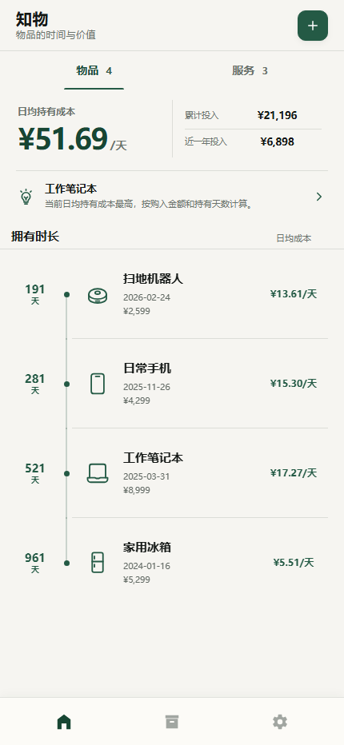
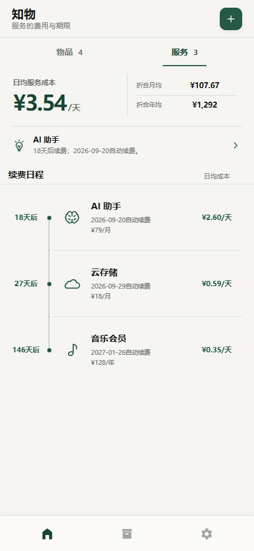
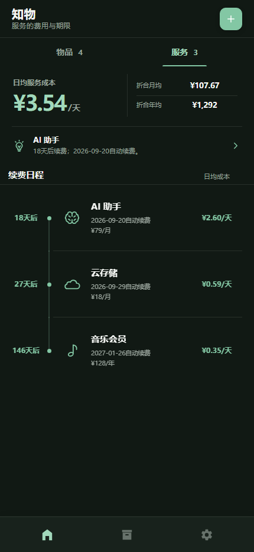
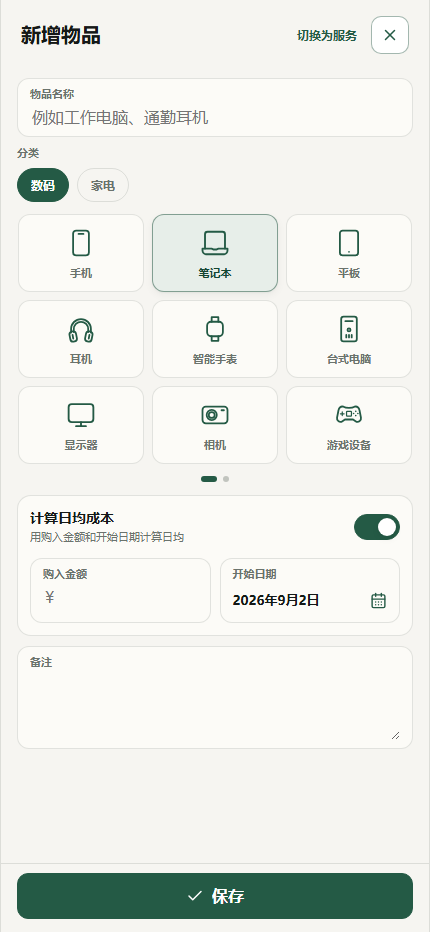
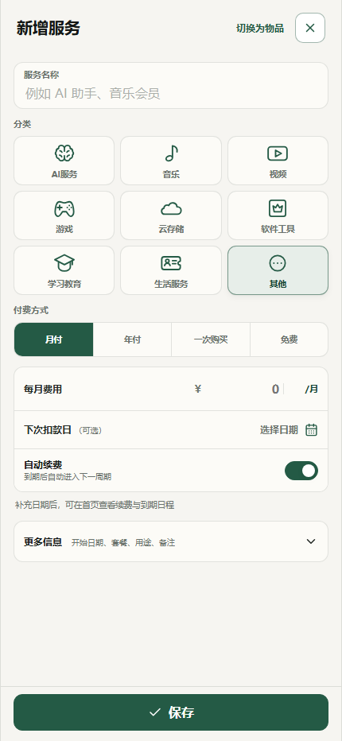
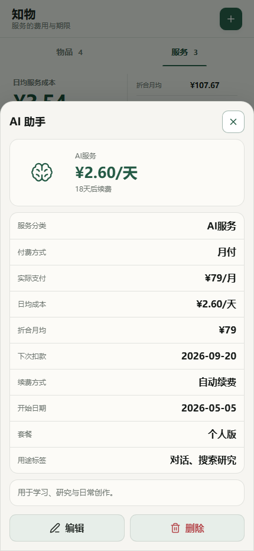

<div align="center">
  
  <h1>知物</h1>
  <p><strong>看见物品的时间，也看见消费的价值。</strong></p>
  <p>一款本地优先的个人物品与订阅价值管理工具。</p>
  <p>
    <a href="README.md">简体中文</a> ·
    <a href="README.en.md">English</a>
  </p>
  <p>
    <a href="https://godiceman.github.io/zhiwu/">在线体验</a> ·
    <a href="https://github.com/GodIceman/zhiwu/releases">版本发布</a> ·
    <a href="CHANGELOG.md">更新日志</a>
  </p>
</div>

> 无需账号，没有后端。你的物品、费用和备注保存在当前设备中，并可随时导出。

## 为什么做知物

消费记录通常止于付款，但一件物品真正的价值发生在之后：它陪伴了多久、使用得是否充分、每天实际花费多少。与此同时，数字订阅不断增加，我们却很难在同一个视角里理解实体物品与持续服务。

知物用“时间 × 成本”重新组织个人消费记录，让物品和服务进入一条可以持续观察的时间线。

<div align="center">
  
  
  
</div>

## 核心能力

- **物品价值**：记录购买金额和拥有日期，自动计算日均持有成本。
- **订阅管理**：统一管理月付、年付、一次购买和免费服务。
- **时间洞察**：通过拥有时长与续费日程，发现最值得关注的记录。
- **清晰分类**：为常见物品和数字服务提供一致的手绘线性图标。
- **本地优先**：数据保存在 IndexedDB，不上传个人消费记录。
- **数据自主**：支持 JSON 备份恢复和 CSV 导出，不锁定用户数据。
- **多端体验**：可作为 Web/PWA 使用，也可构建为 Android 应用。

<div align="center">
  
  
  
</div>

## 数据与隐私

知物不要求注册账号，也没有远程业务后端。应用数据默认仅存储在浏览器或 Android WebView 的本地数据库中。卸载应用、清除站点数据或更换设备前，请先导出 JSON 备份。

完整说明见[数据与隐私](docs/PRIVACY.md)。

## 本地运行

需要 Node.js 22 或更高版本。

```bash
npm install
npm run dev
```

运行完整质量检查：

```bash
npm run check
```

构建 Web/PWA：

```bash
npm run build
```

同步 Android 工程：

```bash
npm run android:sync
```

## 技术实现

- React、TypeScript、Vite
- IndexedDB + `idb`
- Vitest、Testing Library、Playwright
- Vite PWA
- Capacitor Android
- GitHub Actions 与 GitHub Pages

项目的设计决策、质量方法和人机协作过程记录在[《构建知物》](docs/BUILDING_WITH_AI.md)中。代码实现主要由 Codex 在明确的产品规格和验收反馈下完成；产品定义、UI、交互、验收与测试策略由项目发起者负责。

## 参与项目

欢迎提交问题、建议和改进。开始前请阅读[贡献指南](CONTRIBUTING.md)与[安全说明](SECURITY.md)。

## 许可证

知物使用 [MIT License](LICENSE) 开源。
